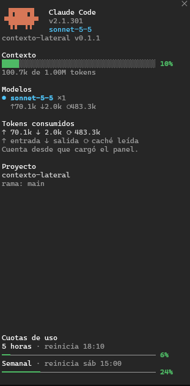

# contexto-lateral

[](LICENSE)
[](https://github.com/mixzplit/contexto-lateral/tags)
[](https://github.com/mixzplit/contexto-lateral/commits/main)

<table>
<tr>
<td valign="top" width="320">

</td>
<td valign="top">

**Un panel lateral para Claude Code** que muestra, en vivo y sin interrumpir la conversación, el estado de tu sesión: el contexto, los modelos, los tokens, los agentes y shells en segundo plano, el proyecto y las cuotas de uso.

**Por qué es útil**

- **Ves cuánto contexto te queda** en lugar de adivinarlo, con una barra y el porcentaje usado.
- **Sabes qué consume cada modelo:** tokens de entrada, salida y caché, por separado.
- **Nada corre a escondidas:** los agentes y shells en segundo plano aparecen mientras corren.
- **Controlas tus cuotas:** el uso de la ventana de 5 horas y el semanal, a la vista.
- **Se actualiza solo** y vive al costado: no ocupa lugar en la conversación.

</td>
</tr>
</table>

## Instalación rápida

1. Agrega el marketplace e instala el mod. Dentro de una sesión de Claude Code:

   ```
   /plugin marketplace add mixzplit/contexto-lateral
   /plugin install contexto-lateral@side-context
   ```

   O desde la terminal:

   ```bash
   claude plugin marketplace add mixzplit/contexto-lateral
   claude plugin install contexto-lateral@side-context
   ```

2. Ejecuta `/reload-plugins`, o abre una sesión nueva.
3. Si el panel no aparece solo, ejecuta `/contexto`. Un panel que nadie pidió se muestra solo desde las 144 columnas de ancho de la terminal; en una más angosta, `/contexto` lo abre.

## Qué muestra

- La versión de Claude Code, el modelo principal y la versión de este mod.
- El contexto usado, con su barra y el porcentaje.
- Los modelos usados, con sus turnos y sus tokens de entrada, salida y caché.
- Los agentes y los shells que corren en segundo plano, mientras corren. De cada agente se ve el contexto que usa; la barra con el porcentaje aparece cuando el mod conoce la ventana de su modelo. Esa ventana se aprende cuando el modelo corre como principal y se recuerda entre sesiones; mientras no se conoce, el panel muestra solo los tokens.
- El proyecto, la rama y el worktree (este último solo si estás en uno). Debajo, una línea «archivos: 5 sin comitear  0 comiteados»: en rojo los archivos «sin comitear» y en verde los «comiteados», que son los que cambiaron en commits desde que abriste la sesión; si son cero, van en gris. Si el panel es demasiado angosto para la línea entera, «archivos:» pasa a su propia línea y los números van debajo. Al cambiar de rama, lo comiteado vuelve a contar desde cero. Se leen con `git` como mucho una vez cada 15 segundos y solo si hubo actividad, sin tomar el lock del índice. Fuera de un repositorio de git no aparecen.
- Los servidores MCP que instalaste vos, con un ✔ verde si están conectados y una ✘ roja si no (también cuando piden iniciar sesión). No muestra los que vienen con Claude Code: los de los plugins y los conectores de claude.ai. Se consultan con `claude mcp list` al abrir la sesión y cada 10 minutos; la consulta tarda unos segundos (mientras lee por primera vez, la sección dice «Consultando estados…»), corre en tu máquina y no gasta tokens del modelo. Con `CLAUDE_CODE_DISABLE_NONESSENTIAL_TRAFFIC` definida no se consulta y la sección no aparece.
- Las cuotas de uso de 5 horas y semanal.

## Requisitos y sistemas

| Sistema | Estado |
|---------|--------|
| Windows | Probado (Windows 10) |
| macOS | No probado |
| Linux | No probado |

- El código no usa nada específico de un sistema operativo, pero eso no reemplaza una prueba. Si lo pruebas en macOS o Linux, cuéntalo en un issue.
- Necesita Claude Code en la terminal. Se desarrolló y probó con la versión 2.1.301.
- `git` es opcional: sin él, el panel muestra «sin git» en lugar de la rama.

## Dónde queda instalado

El mod se instala por usuario, no dentro de tus proyectos. En esta tabla, `~` es tu carpeta personal: en Windows, `C:\Users\<tu usuario>`.

| Qué | Dónde |
|-----|-------|
| Los archivos del mod | `~/.claude/plugins/cache/side-context/contexto-lateral/<versión>/` |
| Este repositorio, clonado como marketplace | `~/.claude/plugins/marketplaces/side-context/` |
| El registro de lo instalado | `~/.claude/plugins/installed_plugins.json` y `~/.claude/plugins/known_marketplaces.json` |
| Lo que Claude Code tiene declarado y habilitado | `extraKnownMarketplaces` y `enabledPlugins` en `~/.claude/settings.json` |
| La opción de avisos de versión, si la cambias | `pluginConfigs` en `~/.claude/settings.json` |
| Lo que el mod recuerda entre sesiones (cuándo consultó por última vez y la ventana de contexto que aprendió de cada modelo) | Un archivo JSON propio del mod, dentro de la carpeta de configuración de Claude Code |

Si defines la variable `CLAUDE_CODE_PLUGIN_CACHE_DIR`, Claude Code usa esa carpeta en lugar de `~/.claude/plugins`.

Cada versión instalada vive en su propia carpeta `<versión>`. Al actualizar, Claude Code borra la anterior unos 14 días después.

## Actualizaciones

Quien instala recibe una versión nueva solo cuando cambia el campo `version` de `.claude-plugin/plugin.json`. Hay tres formas de enterarse y aplicarla:

| Forma | Cómo |
|-------|------|
| Actualización automática de Claude Code | Viene apagada. Actívala en `/plugin`, entra en **Marketplaces**, elige `side-context` y selecciona **Enable auto-update**. Claude Code actualiza en segundo plano y avisa con «Run /reload-plugins to apply». |
| Manual | `/plugin marketplace update side-context` dentro de una sesión, o `claude plugin update contexto-lateral@side-context` desde la terminal. Después, `/reload-plugins` o reiniciar. |
| Aviso del propio mod | El panel muestra «Versión nueva: vX.Y.Z» y el comando para actualizar, y sale un aviso una sola vez por versión. El mod nunca instala nada por su cuenta: tú decides cuándo. |

## Qué consulta el mod en internet

Una vez cada 24 horas, al iniciar una sesión, el mod hace una sola consulta a esta dirección para saber si hay una versión nueva:

```
https://raw.githubusercontent.com/mixzplit/contexto-lateral/main/.claude-plugin/plugin.json
```

- No envía nada de tu sesión ni de tus proyectos. Como en cualquier pedido web, GitHub ve tu dirección IP.
- Solo acepta como respuesta un número con forma `MAJOR.MINOR.PATCH`; cualquier otra cosa se descarta.
- Si la consulta falla, el mod sigue funcionando sin avisar nada.
- Si tienes definida la variable de entorno `CLAUDE_CODE_DISABLE_NONESSENTIAL_TRAFFIC` (con cualquier valor salvo vacío, `0` o `false`), el mod no hace la consulta. Claude Code no frena por sí solo el pedido de un mod, por eso el mod respeta esa variable por su cuenta.
- Para apagarla: abre `/config` y desactiva **Avisar de versiones nuevas**.

## Desinstalar

```bash
claude plugin uninstall contexto-lateral@side-context
```

Para quitar además el marketplace: `claude plugin marketplace remove side-context`. Esto desinstala todos los plugins de ese marketplace y borra sus opciones y datos guardados.

## Contribuir

Los cambios entran por Pull Request y los revisa y prueba el mantenedor. Las reglas de ramas, commits y versiones están en [`docs/git-workflow.md`](docs/git-workflow.md). Para trabajar en el código con Claude Code, las instrucciones del repositorio están en [`.claude/CLAUDE.md`](.claude/CLAUDE.md).

## Licencia

[MIT](LICENSE)
